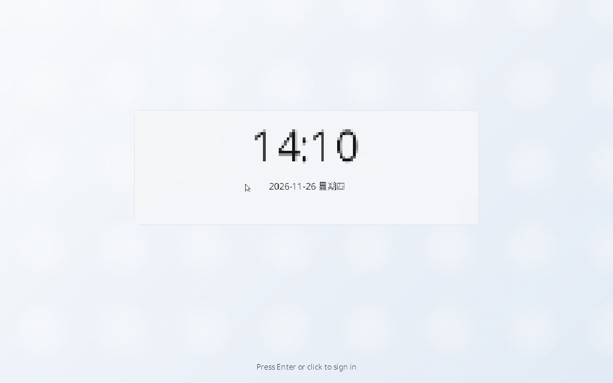
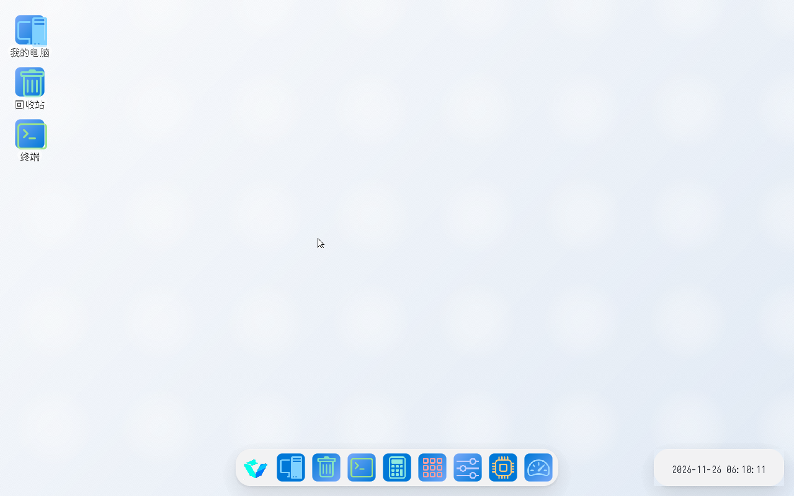
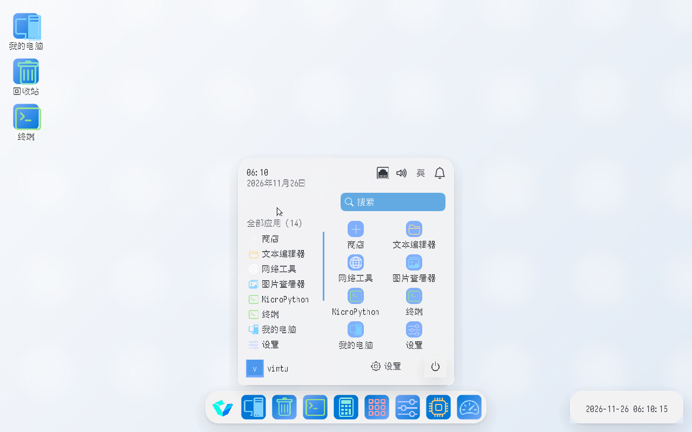
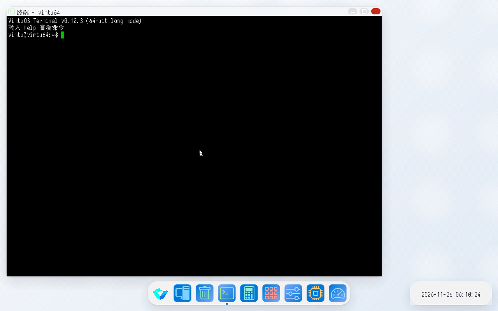
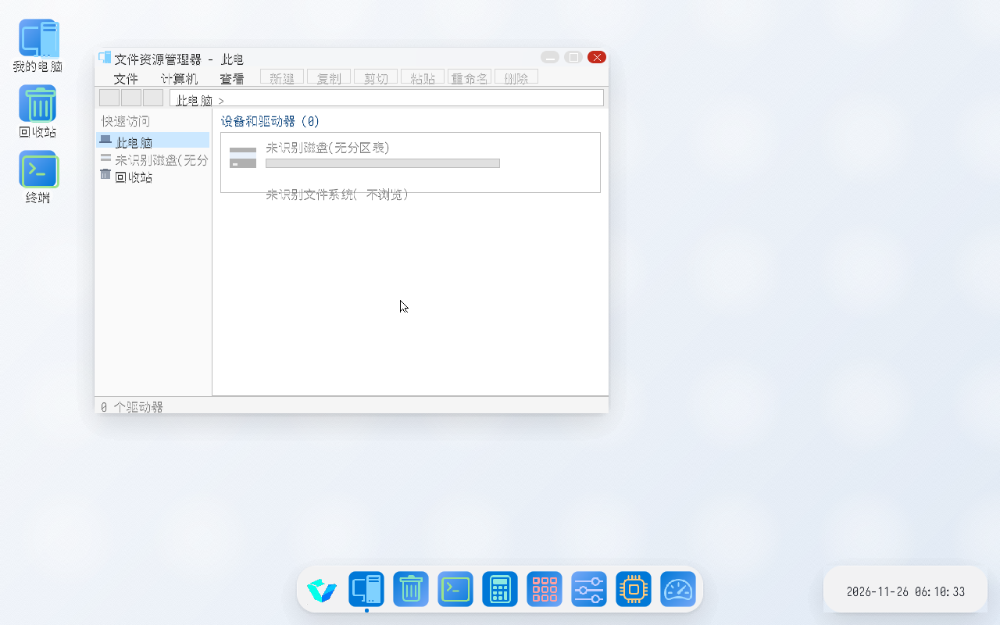
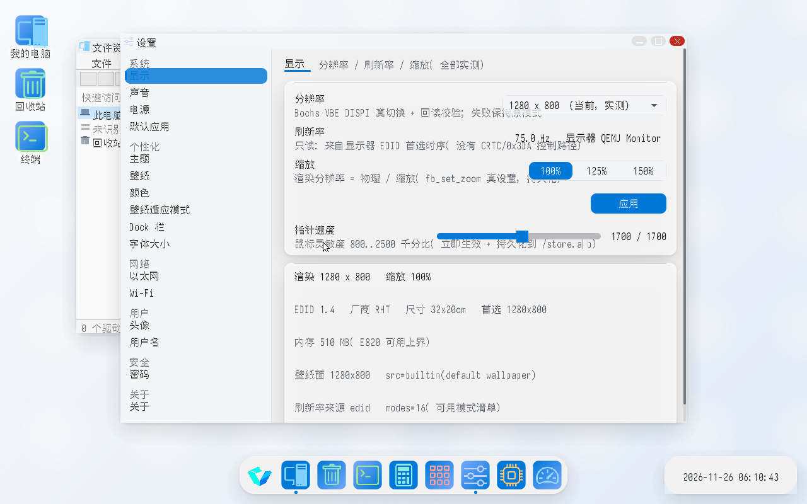
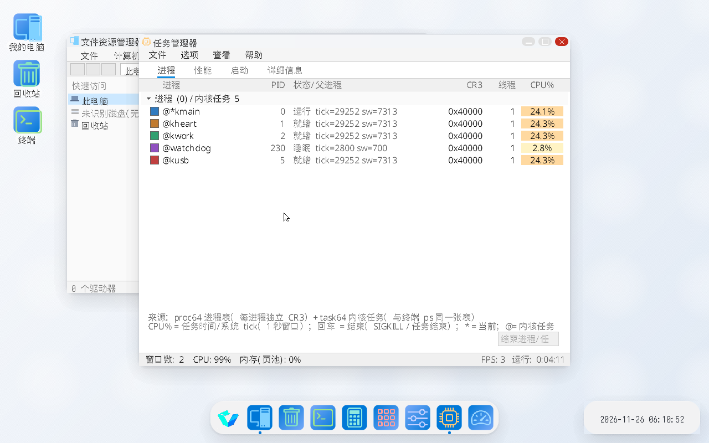
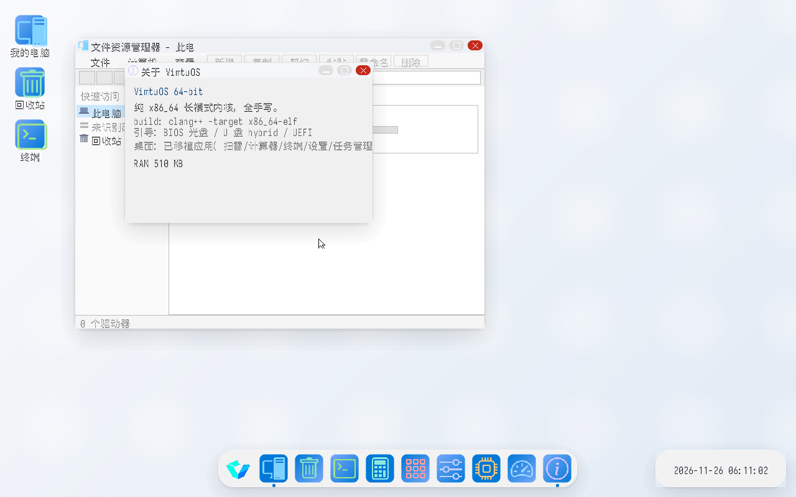
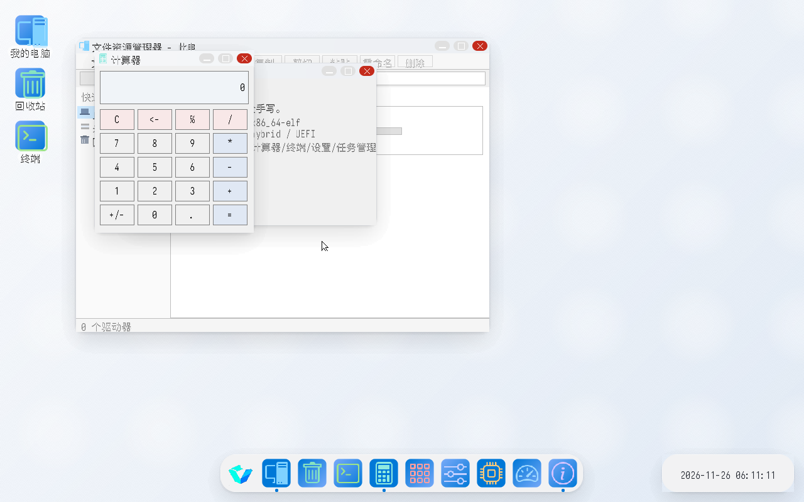

# VimtuOS · Vimtu64

**一个从零手写、纯 64 位、UEFI + BIOS 双引导的混合内核操作系统。**

没有一行 Linux / Windows / BSD 内核代码。引导扇区、内核、文件系统、合成器、包管理器、验收脚本
全部为本仓库原创；桌面、终端、文件管理器、应用商店都能真的用，改的东西重启还在。

`版本 0.12.1` · `x86_64 长模式（纯 64 位，无 32 位兼容层）` · `GPL-3.0` · `C/C++ + Rust + NASM + Python`

| 项目 | 当前值（可复核） |
|---|---|
| 系统内核映像 | **3,575,808 B**（`build64/kernel64_os.bin`），硬闸门 **15 MiB = 15,728,640 B**（`kernel/memlayout64.h:69`） |
| 能力清单 | **110 项，完成 110 / 部分 0 / 未做 0**（`py -3 tests/status_report.py`） |
| 验收脚本 | `tests/` 下 **160** 个 Python 脚本，其中 **151** 个是 `*_test.py` 验收脚本、**101** 个走统一的 `RESULT: PASS/FAIL` 门禁 |
| 引导 | BIOS 两阶段（512 B MBR Stage-1 → 32 KB Stage-2 窗口）+ UEFI 两段式（PE32+ 桩 → 平铺长模式引导器），**两条都实测** |
| 内核安全层 | KPTI 双页表 + SMEP + SMAP + WP 全开（CPU 支持时），不支持则**如实降级并打点** |
| 文件系统 | 原生 **VimtuFS2 v5**（日志 / 配额 / ACL / 快照四特性为格式级能力） |

---

## 一、项目简介

VimtuOS 的目标不是"教学玩具"，而是一个**能当日常系统用**的自研操作系统：

- **纯 64 位**：进长模式后不再回到实模式，内核、驱动、应用、ABI 全 64 位。
- **双固件**：同一份源码同时产出 BIOS 引导（MBR + El Torito + hybrid）与 UEFI 引导（自研 PE32+ 桩 + 长模式引导器），OVMF 与 VMware EFI 双通。
- **混合内核**：控制器留在 Ring 0、协议解析放进 Ring 3 服务进程，中间是零拷贝共享内存通道 + 内核监督重启（详见第三节）。
- **自带生态**：桌面合成器、终端 shell、文件管理器、编辑器、设置、任务管理器、应用商店 + 自研包管理器（`.deb` 的 ar/xz/zstd/tar 全自写）、自有 libc、自有 syscall ABI。
- **三生态加载路径**：原生 ELF64（完整）、Linux ELF（动态 PIE + glibc + 真 `.deb` 可跑）、Windows PE32+（Ring 3 装载器，控制台 exe / GUI `MessageBoxA` 已实测跑通）。

### 系统截图

> 全部是 **QEMU 客人帧缓冲真截图**（`screendump`），不是渲染稿、不是设计稿。
> 拍摄脚本：**[`tools/shots_fresh.py`](tools/shots_fresh.py)** —— 起当前构建的 `build64/system.img`，
> 用键盘驱动到各状态，每张都用**串口自己的打点**确认"这一帧是什么"：
> `[LOCK64] bg blur ready` / `[GUI64] ready` / `[START64] open` /
> `[START64] search q=… hits=1 first=<App> (app=<id>)` + `[APP] <x> opened`。
> 复现：`py -3 tools/shots_fresh.py`

| | |
|---|---|
|  |  |
| **锁屏**（Bayer 抖动分 8 步从黑场揭示） | **桌面**（壁纸 + Dock + 任务栏时钟） |
|  |  |
| **开始菜单**（快捷方式目录投影：14 项 / 8 格） | **终端**（CJK 抗锯齿，一字不断） |
|  |  |
| **我的电脑**（卷与盘符） | **设置**（主题 / 壁纸 / 声音 / Dock…约 40 个键） |
|  |  |
| **任务管理器**（进程 / 性能 / 启动 / 详细信息） | **关于**（这一页上就是当前版本号） |
|  | |
| **计算器** | |

---

## 二、核心文档导航矩阵

只看最关键的几份，其余在 `docs/` 里按需翻。

| 文档 | 讲什么 | 什么时候读 |
|---|---|---|
| **[VimtuOS 系统介绍](docs/VimtuOS系统介绍.md)** | 架构白皮书：内存布局、引导链、ABI、子系统边界 | 第一次接触这个项目 |
| **[项目状态总览](docs/项目状态总览.md)** | 逐项能力台账（含每条断言与串口证据原文） | 想知道"到底做到哪一步" |
| **[开发历程](docs/开发历程.md)** | 从 P1 到 v0.12.1 的完整决策与踩坑记录 | 想知道"为什么这么设计" |
| **[混合驱动架构](docs/混合驱动架构.md)** | Ring 0 控制器 / Ring 3 协议的切分契约 | 想理解本项目的独创部分 |
| **[用户态驱动框架](docs/用户态驱动框架.md)** | 零拷贝通道、共享环、心跳、监督重启的 ABI | 想写一个 Ring 3 驱动 |
| **[内核边界与架构规则](docs/内核边界与架构规则.md)** | 什么能进内核、什么必须出去（含 15 MiB 预算规则） | 提交代码之前 |
| **[引导链架构](docs/引导链架构.md)** | BIOS 两阶段 + UEFI 两段式的每一跳 | 想改引导链 |
| **[应用层与系统调用说明](docs/应用层与系统调用说明.md)** | 自有 `int 0x80` ABI 与 Linux `syscall` ABI 全表 | 编写/移植应用 |
| **[2D 与 3D 加速](docs/2D与3D加速.md)** | 图形栈现状、virgl / SVGA3D 取证结论 | 关心 GPU 路线 |
| **[桌面帧预算](docs/桌面帧预算.md)** | 脏矩形、帧时间、合成器预算 | 关心性能 |
| **[多生态加载盘点与路线图](docs/多生态加载盘点与路线图.md)** | ELF / Linux / Windows 三条加载路径的逐条盘点 | 关心兼容层 |
| **[xHCI 原生驱动接入评估](docs/xHCI原生驱动接入评估.md)** | USB 3.x 控制器现状与缺口 | 关心 USB |
| **[构建与运行说明](构建与运行说明.md)** | 从零装依赖到跑起来 | 第一次构建 |
| **[发布流程](docs/发布流程.md)** | 版本号、构建门禁、Release 回读规则 | 参与发版 |
| **[交接单索引](HANDOVER.md)** | 每个版本的技术交接单（只增不改） | 接手某一块功能 |

---

## 三、独创核心架构

> ## **【VimtuOS 独创混合内核架构】**
> ## **VimtuOS Unique Hybrid Kernel Architecture**
>
> 由项目发起人 **Fanqi89** 主导设计。它既不是"全在 Ring 0"的宏内核，也不是"全在 Ring 3"的
> 纯微内核 —— 它有一条**属于自己的切分比例**：延迟敏感的**控制器**留在 Ring 0，会崩、要能重启、
> 要能替换的**协议解析**推进 Ring 3 服务进程，中间用**零拷贝**共享内存把数据原地交给对方。
> 完整契约见 **[docs/混合驱动架构.md](docs/混合驱动架构.md)**。

### 3.1 15 MiB 内核边界（有界的宏内核主干）

内核体积不是"能塞多少塞多少"，而是**构建期硬闸门**：

| 常量 | 值 | 谁在守它 |
|---|---|---|
| `ML64_KERNEL_SECTORS` | `30,720` 扇区 = **15,728,640 B（15 MiB）** | `kernel/memlayout64.h:69`（唯一真源） |
| `ML64_KERNEL_LBA` | `65`（= 1 + Stage-2 的 64 扇区） | `memlayout64.h:65` |
| `ML64_RAW_SECTORS` | `1,799`（原始区：演示 blob + 中文面字体 + 图标包） | `memlayout64.h:81` |
| 当前实际占用 | **3,575,808 B**（占容量 22.7%） | `build64/kernel64_os.bin` |

- 这个数字派生到三条独立闸门：`build64.sh` 的构建期断言、`tools/kernel_size_report.py` 的上限、
  `tests/a42a64_test.py` 的判据 —— **只有一份定义**，改一处三方一起动。
- **原始区在内核容量之外**（`[30785, 32584)`）。早期布局把 blob 塞进内核区尾部，导致"往里多塞一张图，
  内核就变小"，那是错的；现在内核拿满 15 MiB，blob 自己占一段。
- 内核映像真实上界（含 33 MB 帧缓冲后备）必须 `< 0x04000000`（载荷暂存区），由 `nm` 断言钉死；
  内核堆从 `max(0x07000000, ALIGN(__bss_end))` 起，**内核长得再大也绝不与自身映像重叠**。

### 3.2 混合驱动拓扑（Ring 0 控制器 / Ring 3 协议）

```
                ┌──────────────────────────────────────────────────────────┐
  Ring 3        │  /usr/bin/ext4svc    复杂文件系统协议解析（可崩、可重启） │
  （协议层）     │  /usr/bin/drvwatch   观察者：只读 /proc/vimtu/drivers    │
                │  /bin/wm             Ring 3 合成器（装饰/命中/指针唯一写者）│
                ├──────────────────────────────────────────────────────────┤
                │  零拷贝通道：共享内存 + 按页离散 DMA（不做大块 memcpy）    │
                │  ← 内核报 copied=0；对照路径报 copied=2,093,056（每块）    │
                ├──────────────────────────────────────────────────────────┤
  Ring 0        │  AHCI / NVMe / xHCI 控制器本身 · 中断控制器 · 基础显卡     │
  （控制器）     │  只留"低延迟 + 不懂协议"的那部分                          │
                └──────────────────────────────────────────────────────────┘
```

**为什么这么切**：控制器寄存器操作要求确定性与低延迟（必须在 Ring 0）；协议解析要能崩、能重启、
能整条替换（换成 Ring 3，崩了内核换一个新进程，整机不受影响）。这条线是 VimtuOS 特有的比例。

**实测证据**（`tests/drv64_test.py`，同一块 64 MiB ext4 镜像、同一台 QEMU）：

- 端到端：内核探到 `disk=8 lba=0 proto=ext4` → 拉起服务 → `shm_create/map(2 MiB)` → `register` → 零拷贝读 → 用户态解析。
- **零拷贝正确性**：服务在自己地址空间里对卷首 4 KiB 算 CRC32 = `0xb5d452d3`，与宿主侧对同一镜像算出的 **0xB5D452D3 逐位相等**。
- **省掉的只是拷贝，不是数据**：零拷贝路径内核报 `copied=0`，对照路径报 `copied=2093056`；两条路径读到的总字节数都是 `67108864`。
- 反向 RPC（内核 → 服务）：`STAT/LIST/READ` 单通道单请求、**150 ms 有界等待**、每圈让出 CPU、每次 ≤ 4 KiB。
- `ext4` 的**写方向**也在这条通道上（`R3DRV_F_WRITE` + 私有号 `1036`），宿主侧逐字节核对镜像，
  变化块集合**恰好**是 `{16000..16007}`。

> 关于吞吐，本项目不自欺：QEMU/TCG 下 AHCI 命令的模拟开销把 memcpy 的差距压平了（实测出现过零拷贝
> 82 MB/s 反而低于对照 88 MB/s），所以**不拿吞吐当判据**，只拿"内核自报拷了多少字节"与"内容 CRC 一致"
> 两条确定性证据；"省了多少 CPU 周期"记为**未测**。

### 3.3 零拷贝与自愈机制（真实数字，不是口号）

| 机制 | 真实参数 | 证据 |
|---|---|---|
| **零拷贝 DMA** | 一页一项 PRDT，物理地址认不出就退回 bounce；AHCI 读路径**没有一处 memcpy** | `kernel/ahci64.cpp`；`copied=0` |
| **服务死亡检测** | **同一拍**：进程退出漏斗直接调 `r3drv64_on_die64(pid)`，只认领槽 + 打时间戳，**不做 I/O** | `kernel/r3drv64.cpp` |
| **服务拉起** | **下一个 60 ms 切片**（`PIT_HZ/16`）由内核监督器重启，`attempt=N ok`，新实例重新注册认领同一槽 | `service restart attempt=1 pid=27 ok` |
| **自愈时延可观测** | 两行都带 `lat_ms=`（PIT 250 Hz → 1 tick = 4 ms），**由内核自己报出**，不是宿主侧猜的 | `tests/drv64_test.py` |
| **死锁看门狗** | `WD64_TIMEOUT_MS = 20,000 ms`、`WD64_POLL_MS = 250 ms`；armed 时每 ~10 s 打一行心跳 | `kernel/panic64.h:43` |
| **看门狗宽容度** | 帧内/用户动作里读写盘时**成对** `panic64_watchdog_pause64/unpause64`（`kernel/*.cpp` 共 **42 处**），避免把"盘慢"误判成"死锁" | `kernel/*.cpp` |

> 看门狗是**死锁探测器**，不是性能闸门。它判定的对象是"桌面帧循环停滞"，而不是"某次 I/O 慢"。

### 3.4 层级定位（往混合内核走的第二步）

当前落地的是**混合驱动架构**，它是通往**混合内核架构**的第一步：

- 保留宏内核的高效系统调用主干（两条入口：自有 `int 0x80` + Linux `syscall`）；
- 引入微内核式的 IPC：共享内存对象 + 阻塞等待 + 端口级唤醒 + 内核监督重启；
- 已经做到的：可崩溃恢复的服务化协议层、零拷贝数据面、按槽幂等注册、只读回退；
- 还没做的：真正的驱动**权限模型**（能 `register` 就能对该盘发任意 LBA 读）、协议层校验和证书（
  "进程活着但算错了"目前检测不到）。这两条如实记在 [用户态驱动框架 §7](docs/用户态驱动框架.md)。

---

## 四、质量保障与自动化测试

> **VimtuOS 具备极高的工程严谨性：内置 151 个独立验收脚本，覆盖引导、内存、VFS、Ring 3 驱动、
> 图形栈、安装器、三生态加载等全部核心模块 —— 每一条断言都有串口打点、像素判据或宿主侧独立解析支撑。**

| 指标 | 数值 | 怎么数出来的 |
|---|---|---|
| 登记能力项 | **110**（完成 110 / 部分 0 / 未做 0） | `py -3 tests/status_report.py` |
| 验收脚本 | **151**（`tests/*_test.py`） | `(Get-ChildItem tests -Filter *_test.py).Count` |
| 统一门禁格式 | **101** 个脚本输出 `RESULT: PASS\|FAIL` | 全目录 `Select-String 'RESULT:'` |
| 测试代码量 | **78,224 行**（其中非空 70,131 行；`tests/*.py` 共 160 个文件） | 逐文件统计 `tests/*.py` 行数 |

**这套体系的三条纪律**（比脚本数量更重要）：

1. **每条结论必须能落到证据上**：串口打点原文、宿主侧独立实现（如 `tools/pe_crosscheck.py`、`zlib.crc32`、宿主侧 ext4/VimtuFS2 解析器）、或像素级判据（`max|d|` / 墨点数 / 连通分量）。拿不到证据就写 **UNVERIFIED**。
2. **判据与事实不符时先修脚本，但绝不放宽断言强度**。例子：锁屏汉字墨高按 em 口径重定，而不是把区间拉大；"有墨迹"必须同时看到窗口自己的底色，不能只看非黑像素。
3. **"部分绿"不许冒充"全绿"**：环境受限的判据记 `SKIP(env)`（不算通过、也不冤枉产品），例如宿主屏装不下 1:1 客人窗口时整窗截帧只对得上 84%。

常用命令：

```powershell
py -3 tests/status_report.py            # 能力台账（秒级）
py -3 tests/status_report.py --full     # 真跑全部验收（数小时，串行）
py -3 tests/version64_test.py           # 版本串门禁（8 项）
py -3 tests/iso64_test.py               # 内核自检 + KPTI/SMEP/SMAP/WP 审计
py -3 tests/<模块>_test.py              # 单跑一条
```

---

## 五、已实现的技术特性

### 5.1 引导与安装

| 能力 | 现状 | 关键实现 |
|---|---|---|
| BIOS 引导 | 两阶段：**512 B MBR Stage-1** → **32 KB Stage-2 窗口**（`loader64.bin` 实测 4,090 B） | `boot/boot.asm` / `boot/loader64.asm` |
| 光盘 / U 盘引导 | El Torito + hybrid MBR；Stage-2 走 ATAPI 或 `INT 13h` 分块读 | `boot/cdiso.asm` |
| UEFI 引导 | 两段式：自研 **PE32+ 桩** → 平铺长模式引导器（`UEFI64.BIN` 45,056 B，装载于 `0x06000000`） | `boot/efi/` |
| 分区表 | MBR + GPT（含装到 GPT 盘、主备两份 GPT 一起重算 CRC） | `kernel/part64.cpp` |
| 装完能自举 | v0.10.8 起 UEFI 能从装好的硬盘自己起来（直映窗口 48 MB → 128 MB、ESP 只写内核真实长度） | `tests/uefi_install64_test.py` |
| 安装向导 | Win10 风格；新建/删除/格式化分区**真实写盘**且**两步确认**；装完卷按分区大小**整体重排扩容** | `kernel/setup64.cpp` |

### 5.2 内核

| 子系统 | 现状 |
|---|---|
| 内存 | 物理页池（按 E820 usable 段填充，非连续）+ 48 MB 内核堆 + 归属记账；**4 GB 机器报 4094 MiB**（E820 口径，不是池上界） |
| 调度 | 抢占式多任务 + **SMP**（AP 跳板含缓存刷写/SIPI 重发/进度面包屑） |
| 进程 | 每进程独立地址空间（BIOS 路径）；`fork/execve/wait4/kill` 真语义；UEFI 固件页表下**如实降级并打点** |
| 信号 | 用户栈信号帧 + `rt_sigreturn` 真投递（含 `SIGPIPE`、`SIGSEGV`） |
| 中断 | PIC ↔ APIC/IOAPIC 双模；PIT 250 Hz |
| 设备 | PCI 枚举、ACPI（含 S5 关机 / FADT RESET_REG 重启）、PS/2 键鼠、PATA/AHCI/NVMe、EHCI/xHCI、e1000、HDA 音频、virtio-gpu(2D)、VMware SVGA |
| 内核门面 | `/dev/dri/card0`（ioctl 枚举模式 + dumb buffer + `PAGE_FLIP` + `WAIT_VBLANK`）、`/dev/input/event0` 与 `event1`（evdev 24 B 事件）、`/proc` 与 `/sys` 合成节点 |

### 5.3 内核安全层（v0.11.9 → v0.12.0）

| 机制 | 状态 | 证据（串口原文） |
|---|---|---|
| **KPTI 双页表** | 完整（BIOS 路径） | `[KPTI64] init ok … tramp=50 kpti=1`；`[ISO64] audit pid=26 … khigh=0 … kind=user` |
| **SMEP** | 开（CPU 支持时） | `[ISO64] hw wp=1 smep=1 smep_supported=1` |
| **SMAP** | **开**（CPU 支持时）：`elf64` / `syscall64` / `sig64` / `proc64` / `wl64` 五个文件共 **29 处**成对 `STAC/CLAC`，开窗用**引用计数**（可嵌套） | `smap_supported=1 smap_on=1 cr4=…`；`-cpu max` 全程 `[SMAP64] violation` **0 条** |
| **WP** | 开（根因修正：`iso64_init64()` 现在无条件执行，不再套在 `user64_available64()` 分支里） | `[ISO64] selftest PASS mask=63 … wp_leak=0`；`[ISO64] wp check at gui-entry wp=1` |
| **违规处置** | 用户态违规 → `SIG64_SEGV` 杀进程；内核态违规**绝不 PANIC** → 关 SMAP 打 `[SMAP64] smap degraded` 重试 | `kernel/iso64.cpp` |

> 设计取向：**宁可降级也不变砖**。安全层永远不把"整机停机"当成"更安全"。

### 5.4 文件系统与存储

- **VimtuFS2 v5**（新格式化产出）：目录树、权限（uid/gid/mode）、mtime、kind、符号链接（最多 8 层）+
  **四个格式级特性**：元数据日志 / 配额 / ACL / 只读快照（默认全部关闭，按卷头位开启）。
  v4 旧卷仍可挂载读写，可 `vfs64_migrate64` 就地升 v5（不需要搬数据）。
- **ext4**：读 + 写在 **Ring 3 服务**里（`user/drivers/ext4svc.c`），内核不解析 ext4，只发反向 RPC。
  只支持 extents（`depth ≤ 1`），无 `metadata_csum`、无 journal 重放、无 `STATFS`。
- **FAT32**：只读浏览（含 VFAT 长名）+ **U 盘可写**（新建/覆盖/建目录/删除/截断 + 写后读回校验）。
- **ISO9660**：安装介质按真 ISO9660 主卷描述符识别。
- 写盘纪律：先数据后 inode 的提交顺序；裸盘降级槽带醒目 WARN；载体不是 VimtuFS2 卷时开机直接
  打 `[CONF64] WARN NOT-PERSISTENT …`，不让用户靠猜。

### 5.5 图形栈（CPU + GPU 混合渲染判定）

- **混合呈现**：Ring 3 光栅化 + 内核只做传输与扫描输出 —— 有设备走 `vgpu64_blit64`（`path=gpu`），
  无设备走 `fb_soft_flip_region64`（`path=cpu`），**每条路径都打点**，不假装有硬件加速。
- **DRM/KMS 内核门面**：ring3 可 `open("/dev/dri/card0")`，用既有 `ioctl` 枚举 `VERSION/GET_CAP/
  GETRESOURCES/GETCRTC/GETCONNECTOR`、建 CPU 可写 dumb buffer、`PAGE_FLIP` 上屏、`WAIT_VBLANK` 等回扫。
  dumb buffer 的 ring3 可写性靠 `MAP_DUMB` 逐页挂进调用方页表，**不新增任何 syscall 号**。
- **GPU 身份探测**：内核自己扫 PCI 显示控制器（class 0x03）、认厂商（Intel/AMD/NVIDIA/未知）、
  用"写全 1 回读"量出 BAR 真实窗口、开 mem-decode + bus-master 并**回读确认**，
  再对三家各读一个**只读**身份寄存器。AMD/NVIDIA/未知厂商走同一段 `no-touch` 代码 —— 不写厂商寄存器、不接管 scanout。
- **Win11 风格视觉**：设计 Token 表（颜色/圆角/间距/动效）由 **Rust 生成并链接进内核**，
  UI 与内核共用同一份真源；毛玻璃、大圆角、双层浅阴影、居中 Dock、最小化飞行、淡出淡入（Bayer 抖动分步）。
- **帧预算**（QEMU TCG 实测）：空闲 **1 帧/s、单帧 5~7 ms**；脏矩形是**最多 4 块的队列**；
  启动动画按**真实墙钟**校准（TCG 下 PIT 虚拟时钟比墙钟快约 1.9 倍，按 tick 算的 4 秒只有 2.1 秒）。
- **图像解码**：PNG / JPEG / BMP 支持**解码期抽样**（PNG 流式 inflate 逐行降采样、JPEG 按 DCT 块求平均、BMP 逐行/列抽样），
  内存只跟目标尺寸有关、与源分辨率无关；**GIF 只解首帧**（静态显示，不做动画，打点如实标 `frames=1(first)`）。

### 5.6 桌面与应用（全部用户态）

- 桌面：窗口拖动/八向缩放/最小化/任务栏/Dock 窗口列表、脏矩形局部重绘、右键上下文菜单、桌面图标真实文件语义、回收站（同卷改名 + 每项元数据）。
- 锁屏 → 登录：多用户、口令 **SHA-256 × 1000 轮 + salt**、头像/主题/壁纸按用户持久化。
- 开始菜单：**快捷方式目录的投影** —— 扫 `/apps`、`/usr/share/applications`、`/apps/desktop` 的
  `*.lnk` / `*.desktop`（`name=/en=/exec=/icon=`），删掉文件就消失、放进去就出现；扫入项**不写盘**（可删除性）。
- 应用注册表 `/etc/apps.json`：12 个内置项 + 扫描项；用户应用用 **exec 路径稳定哈希**当 id（跨重启恒定）。
- 应用（`/bin/*`）：终端 shell、文件管理器、文本编辑器、计算器、扫雷、任务管理器、系统监视器、
  设置、关于、回收站、应用商店 + 包管理器（`.deb` 与自有 VAP64）、图片查看器、网络工具、
  Ring 3 合成器 `/bin/wm`、PE 装载器 `/bin/peload`、PE 体检器 `/bin/peinfo`、Ring 3 ext4 服务、drvwatch。
- 运行时：自有 libc、musl 静态程序、自有动态链接器、Lua、TCC、gzip、tar、make、busybox、**MicroPython**（终端里 `1+1` → `2`）。
- 设置：主题/壁纸/头像/字号/鼠标灵敏度/缩放/声音/Dock 尺寸… 约 40 个键持久化（store A/B 双槽 + 世代号）。

### 5.7 三生态加载

| 生态 | 阶段 | 现状 |
|---|---|---|
| **原生 VimtuOS ELF64** | 可用（主路径） | 自有 `int 0x80` ABI + 自有 libc，整套桌面/终端/服务都跑在这条路上 |
| **Linux ELF** | 全链路贯通 | `syscall` 指令路径覆盖 **110 个标准调用号 + 7 个 VimtuFS2 私有扩展号**；能装**原样 xz 的 Debian `.deb`**、能跑**真发行版二进制**（Debian `/usr/bin/hello` 打印 `Hello, world!` 且退出码 0）；`linuxapp64_test` 36/36 |
| **Windows PE32+** | 控制台 + GUI 第一批 | **Ring 3** 装载器 `/bin/peload`：解析 PE32+ → mmap → 逐节拷贝 → `IMAGE_REL_BASED_DIR64` 重定位 → 填 IAT（Win64→SysV 汇编跳板 + 32 B 影子空间）→ 按节 `mprotect`（W^X 不做例外）→ 直接 `call` 入口。`cui.exe` 真打印自己的 `printf`、`gui.exe` 的 `MessageBoxA` 弹出真窗口、`gsprobe.exe` 自证 TEB/PEB/GS.base |

> **PE 一行都没进内核** —— 格式解析器不拿 Ring 0 权限，与"ext4 放 Ring 3"是同一条纪律。

### 5.8 硬件驱动

- 块设备：ATA PIO / ATAPI / **AHCI**（散列 DMA 零拷贝读 + 写）/ **NVMe**。
- USB：**EHCI**（USB 2.0）与 **原生 xHCI**（USB 3.x，`kernel/xhci64.cpp` **1,551 行**）：完整控制器路径
  （HCRST、命令环、事件环 + ERST、DCBAA + scratchpad、Enable Slot/Address Device/Configure Endpoint、
  控制/批量/中断传输、速率协商、门铃位序自探），键盘 HID 与 U 盘 `READ(10)` 都实测通。
- 显示：VBE / GOP、EDID + DDC、virtio-gpu(2D)、VMware SVGA II（只读探测 + FIFO + present 通路）。
- 其它：e1000 + slirp（ARP/DNS/TCP，`busybox ping` 用 raw ICMP socket 真跑通）、HDA 音频、PS/2 键鼠。

---

## 六、诚实的边界（没做完的一条都不许假装）

> 这一节比上一节更重要。下列每一条都是**当前代码里确实没有**的东西。

### 6.1 Linux ELF 兼容层进度

- ✅ 已实现：`read/write/open/openat/close/stat/fstat/statfs/fstatfs/lseek/mmap/mprotect/munmap/brk/
  ioctl/readv/writev/access/pipe/dup/dup2/nanosleep/getpid/fork/execve/wait4/kill/uname/fcntl/rename/
  mkdir/rmdir/unlink/getcwd/clock_gettime/getdents64/getrandom/arch_prctl/readlink/symlink/setitimer/
  socket/connect/send/recv/select/poll/epoll/getrlimit…`（合计 **110 个标准号**）
- ✅ 动态加载：`PT_INTERP` + PIE/load bias + 按段分块读盘，musl `ld-musl-x86_64.so.1` 与 glibc
  `ld-linux-x86-64.so.2` 都能被内核装载。
- ❌ **线程**：`clone` 只支持 fork 语义，`CLONE_VM/CLONE_THREAD` → `-ENOSYS`。futex 有 WAIT/WAKE
  但是"轮询式等待"（1 ms 重查），**pthread 仍然跑不起来**。
- ❌ 服务端 socket：`accept` / `listen` 如实返回 `-EOPNOTSUPP`（只做客户端）。
- ❌ swap / COW / ASLR：内存不足直接 `-ENOMEM`；`fork` 整页物理复制；映像地址确定。
- ⚠️ `/proc` 内容不完整、无 pty、无 vDSO、`link` 硬链接 `-EPERM`（VimtuFS2 无硬链接）、
  `siginfo`/`sigaltstack`/`SA_RESTART`/实时信号排队/作业控制都没有。
- ⚠️ `clone` 之外的**完整覆盖面**只到 `tests/linuxapp64_test.py` 那 36 条 —— **不是**"随便哪个发行版程序都能跑"。

### 6.2 Windows PE 兼容层进度

- ✅ 已实现（W1/W2/W3 第一批）：PE32+ 解析、DIR64 重定位、IAT 填充、TEB/PEB + `GS.base`、
  老式 `msvcrt` 34 条桩 + `kernel32` 10 条、最小 `vfprintf`、`MessageBoxA` 走本系统窗口抽象。
- ❌ 未实现：**SEH**（`.pdata` / `RtlUnwind`）、TLS 回调、资源加载、延迟导入、bound import、
  **`gdi32` 一个函数都没有**、标准控件、`DialogBox`、真 `CreateWindowExA`、**PE32（32 位）映像**。
- ❌ **桌面集成没做**：装载器目前只经命令行暴露（`run /bin/peload X.exe`）；资源管理器双击 `.exe` 仍**如实报"无法运行"**。
- ⚠️ GUI 对话框目前只能落在 **320×200 的内核面板**里（`wl64.cpp` 拒绝更大的 surface），真·全屏多窗口合成还没做。
- ⚠️ "鼠标点 OK"这条判据记 `SKIP(env)`（宿主显示环境无法把光标可靠送到按钮上）。

### 6.3 原生 xHCI USB 驱动进度

- ✅ 已实现：PCI 枚举与能力复核、64 位 MMIO BAR0、HCRST 软复位、命令环、事件环 + ERST + ERDP、
  DCBAA + scratchpad、Enable Slot / Address Device(BSR 两段) / Configure Endpoint、控制 IN/OUT、
  批量 IN/OUT、中断 IN（HID 键盘）、每端点 Transfer Ring、速率协商、门铃位序自探。
  上限 **2 台设备 / 64 TRB 环 / 64 事件**。
- ❌ 未实现：**USB hub**、运行期**热插拔**枚举、多配置/多接口切换、**USB 鼠标**、带宽协商、
  **MSI/MSI-X 与中断驱动**（现在是 `kusb` 线程约每 12 ms 轮询一次）、挂起恢复、
  存储 **`WRITE(10)`**（只暴露 `READ(10)`，所以 U 盘目前只读）。
- ⚠️ USB 键鼠的**完整语义**未验证（键盘与存储已可用）。

### 6.4 已知的闭源虚拟机兼容性问题（UNVERIFIED）

- **VMware SVGA II 的宿主呈现**：guest 侧帧缓冲内容正确、`SVGA_CMD_UPDATE` 确实进了 FIFO，
  但**宿主不回 SYNC**（`[VMWARE] fifo update(0,0,64,64) sync=TIMEOUT next=21`），于是宿主窗口可能一直黑屏。
  已排除的是"没写显存"这条；未验的是"宿主到底读不读我们写的那块"。记为
  **已知的闭源虚拟机兼容性问题（UNVERIFIED）**。
- VMware 侧还有两条硬约束：`guestOS` 必须是 **64 位类型**（否则 CPUID 长模式位被屏蔽 → 全黑无串口）、
  运行期 `mov cr3` 在某些 VMware EFI 配置下会复位（所以 UEFI 路径**不开 KPTI**，如实打点
  `reason=boot-cr3-not-own`）。
- QEMU（`-vga std` / `virtio` / `qxl`）不受影响，桌面照常 `[GUI64] ready`。

### 6.5 其它缺口（同样一条不抹）

- **无真 Wayland 线协议**：`wl64` 是内核自定义 surface ABI（create/attach/damage/commit/export/ack），
  没有 xdg_shell / libwayland / 协议 XML，Linux 图形程序不能直接用。
- **无 GPU 通用加速**：virtio-gpu 只做 2D 上屏，**合成仍在 CPU**；无 DRM 式命令提交、无 3D
  （QEMU 的 virgl 卡在宿主 `vrend` 拒绝 `BIND_OBJECT`；VMware 的 SVGA3D 命令协议未实现）。
- **无 Secure Boot 签名验证**、**无无线网卡**（802.11/WPA）、**无输入法（中文 IME）**、
  **无硬件视频解码**、**无 S3/S4 休眠**、**无内核模块加载**（单体内核）、**W^X 非全局强制**（只对部分程序用链接脚本 + 构建断言保证）。
- **包管理边界**：只解析一层依赖、`update` 只比对提示不自动升级；带 `preinst/postinst` 的 `.deb` 整包拒绝。
- **性能项**：ATA 单扇区读约 13 ms（QEMU 上本该是微秒级）；首次挂载 100 GiB 卷要读完 26 MB 位图（约 36 s）；inode 上限仍是 512。

---

## 七、代码目录结构树

```
Vimtu64/
├── boot/                      ★ 引导链（两条固件路径，互不依赖）
│   ├── boot.asm               512 B MBR Stage-1（按 64 扇区读 Stage-2）
│   ├── cdiso.asm              El Torito 光盘 / hybrid U 盘 Stage-1
│   ├── hybrid_mbr.asm         hybrid ISO 的 MBR（U 盘可写）
│   ├── loader64.asm           Stage-2：实模式 → 长模式 + ATA/ATAPI 读内核（32 KB 窗口）
│   ├── loader64_atapi.inc     ATAPI 读盘（安装光盘路径）
│   └── efi/                   UEFI：PE32+ 桩 + 平铺长模式引导器（efi_main.c / enter64.asm）
│
├── kernel/                    ★ 内核（181 个文件；15 MiB 容量硬闸门）
│   ├── kernel64.cpp           内核入口 / 自检 / 系统 or 安装程序两条路径
│   ├── memlayout64.h          ★ 内存与磁盘布局唯一真源（所有闸门的分子）
│   ├── mem64.cpp              页池（按 E820 段填充）+ 内核堆 + 归属记账
│   ├── kpti64.cpp / kpti_blob64.asm   KPTI 双页表与共享入口区
│   ├── iso64.cpp              SMEP / SMAP / WP 与 SMAP 开窗审计
│   ├── task64.cpp / proc64.cpp / sig64.cpp / elf64.cpp  调度 / 进程 / 信号 / ELF
│   ├── syscall64.cpp          两条入口：自有 int 0x80 + Linux syscall（110 标准号 + 7 私有号）
│   ├── vfs64.cpp / fs64.cpp / store64.cpp / fat64.cpp    VimtuFS2 v5 / 卷分派 / 设置 / FAT32
│   ├── ext4vol64.cpp          内核侧 ext4 反向 RPC 客户端（协议解析在 ring3）
│   ├── r3drv64.cpp + r3drv_abi.h   ★ Ring 3 驱动框架：零拷贝 + 心跳 + 监督重启
│   ├── ahci64 / nvme64 / ata64 / part64                   块设备与分区
│   ├── ehci64 / xhci64 / usb64                            USB 2.0 / 3.x 与设备层
│   ├── gui64.cpp / gfx64.cpp / theme64.cpp / panels64.cpp 桌面外壳 / 图元 / 设计 Token / 面板
│   ├── wl64.cpp / drm64.cpp / gpu64.cpp / intel_gpu64.cpp / vmware64.cpp / virtio_gpu64.cpp
│   ├── startmenu64 / dockmenu64 / deskdir64 / desktopops64 / explorer64 / trash64
│   ├── font.cpp / icons64.cpp / img64.cpp                 字形光栅化 / 图标 / PNG·JPEG·BMP·GIF 解码
│   ├── panic64.cpp            蓝屏 + 看门狗（20 s 超时 / 250 ms 轮询）
│   └── …
│
├── user/                      ★ 用户态（全部 Ring 3，内核不为它们开后门）
│   ├── lib/                   自有 libc + wl/drm 客户端 + crt0 + 链接脚本
│   ├── shell/                 终端 shell
│   ├── wm/                    Ring 3 合成器（顶栏 / 时钟 / 面板 / TTF 标题）
│   ├── drivers/               ext4svc.c（Ring 3 ext4 服务）+ drvwatch.c（观察者）
│   ├── store/                 应用商店 store.c + vpkg.c + ar/xz/zstd/gzip/tar 引擎
│   ├── win/                   peload（PE 装载器）+ peload_crt（Windows 运行期）+ peinfo
│   ├── viewer/ lua/ tcc/ busybox/ make/ tar/ gzip/ micropython/ net/ vmtool/
│   ├── apps/                  示例与夹具程序（hello / libctest / dynhello / wlclient …）
│   └── …
│
├── tests/                     ★ 160 个 Python 脚本（151 个 *_test.py，78,224 行）
├── tools/                     构建期工具：造卷 / 打包 / LBA 回填 / 宿主侧交叉校验（pe_crosscheck.py）
├── third_party/               musl / busybox / lua / tcc / make / micropython / lzma / stb
├── gui_rs/                    Rust 设计 Token 生成器（颜色 / 圆角 / 间距 / 动效）
├── sdk/software-template/     第三方软件模板（打包 / 图标 / 证据约定）
├── res/wallpapers/            壁纸素材（构建期进 `/Wallpapers/`）
├── docs/                      白皮书 / 报告 / 发布说明 / 交接单 / 截图
│   ├── handover/              每版技术交接单（只增不改）
│   ├── screenshots/           客人帧缓冲真截图
│   └── fonts/                 字体许可全文
├── legacy32/                  已退役的 32 位工程（历史存档，可整目录删除）
├── build64.sh                 ★ 唯一构建入口（版本号唯一真源 + 所有体积闸门）
├── build_uefi.sh              UEFI 引导器单独构建（-base 与装载地址必须一致）
├── HANDOVER.md                交接单索引（顶部最新）
├── LICENSE                    GPL-3.0 全文
└── FONTS.md                   字体来源 / 许可 / SHA256 清单
```

---

## 八、快速开始（Quick Start）

### 8.1 依赖（Windows + MSYS2 为参考环境）

```bash
# 工具链
pacman -S --noconfirm --needed mingw-w64-x86_64-clang mingw-w64-x86_64-lld \
                               mingw-w64-x86_64-compiler-rt nasm xorriso
pip install fonttools pillow        # 字体子集化 / 图标生成
```

- 字体源文件**不进仓**：按 [FONTS.md](FONTS.md) 把 Noto Sans / Noto Sans SC / Sarasa Mono SC / Unifont
  放进 `Fonts-open/`（缺失 = 构建**硬失败**，不会静默用替代字体）。
- QEMU 用于运行与自动化验收（默认路径 `C:\Program Files\qemu\qemu-system-x86_64.exe`）。

### 8.2 构建

```bash
git clone https://github.com/Fanqi89/VimtuOS.git
cd VimtuOS/Vimtu64
bash build64.sh          # 10~15 分钟；0 error 才算过
```

产出：

| 文件 | 说明 |
|---|---|
| `vimtu64-64.iso` | 三合一安装盘（BIOS 光盘 + UEFI 光盘 + hybrid U 盘）≈ 93.5 MB |
| `vimtu64-64.img` | 安装介质裸盘镜像 ≈ 42.7 MB |
| `vimtu64-64-disk.img` | **日常数据盘**（只在不存在时从 sysdisk 初始化一次，重建**不覆盖**） |
| `build64/kernel64_os.bin` | 系统内核（当前 3,575,808 B） |
| `build64/kernel64.bin` | 安装程序内核（带 `-DVIMTU_INSTALLER_MEDIA`） |

> 三块盘别混：`vimtu64-64.img` 是**安装介质**（单盘启动会进安装向导）、`build64/sysdisk.img` 是**构建产物**
> （每次构建重拼，"重启数据就丢"的真相就是这条）、`vimtu64-64-disk.img` 才是**日常盘**。

### 8.3 跑起来（QEMU）

```bash
# ① 日常使用（开箱即用，改的东西重启还在）
qemu-system-x86_64 -m 512 -vga std -drive format=raw,file=vimtu64-64-disk.img

# ② 完整安装：ISO 当光盘 + 一块空盘当目标盘
qemu-system-x86_64 -m 512 -cdrom vimtu64-64.iso \
  -drive format=raw,file=target.img -boot order=d -vga std

# ③ UEFI 路径
qemu-system-x86_64 -m 512 -bios OVMF.fd -cdrom vimtu64-64.iso \
  -drive format=raw,file=target.img -boot order=d
```

- 默认用户 `vimtu`、**无口令**（安装时可设）；锁屏回车两次进桌面。
- 想要写得更稳：`-drive format=raw,file=…,cache=writethrough`；关机请走系统"关机"按钮或 monitor `quit`，
  直接 `kill` QEMU 可能丢掉写缓存里最后几块。
- 只有**带 VimtuFS2 主分区（MBR type=0x07）**的盘才真落盘，否则开机打
  `[CONF64] WARN NOT-PERSISTENT …`。

### 8.4 验证

```bash
py -3 tests/status_report.py       # 110 项能力台账
py -3 tests/version64_test.py      # 版本串门禁
py -3 tests/iso64_test.py          # 内核自检 + 安全层审计
py -3 tests/status_report.py --full   # 全量（数小时，串行）
```

---

## 九、开源协议（License）

- **代码：GNU General Public License v3.0** —— 全文见 [LICENSE](LICENSE)。
- **字体**：Noto Sans / Noto Sans SC / Sarasa Mono SC / Unifont 均为开放许可（SIL OFL 1.1 等），
  许可全文在 [`docs/fonts/`](docs/fonts/)，逐文件的 URL / 版本 / 协议 / SHA256 见 [FONTS.md](FONTS.md)。
- **第三方组件**：musl / busybox / lua / tcc / make / MicroPython / stb 各自保留原许可，见 `third_party/`。
- **免责**：**这是一个仍在开发中的操作系统**。它会崩溃、会丢数据、会不兼容你的硬件。
  不要把它装在唯一一台电脑上，不要在里放重要文件。按 GPL-3.0 的免责条款，作者不承担任何损失责任。

贡献之前请先读 **[内核边界与架构规则](docs/内核边界与架构规则.md)** —— 尤其是"什么不许进内核"与
"每条结论必须有证据"这两条。

---

## English summary

VimtuOS is a **from-scratch x86_64 hybrid-kernel operating system** — no Linux, Windows or BSD kernel
code. It boots on both **BIOS** (512-byte MBR stage-1 → 32 KB stage-2 window) and **UEFI** (custom
PE32+ stub → flat long-mode loader), installs from a hybrid ISO onto MBR/GPT disks, and boots again
from the installed disk.

**The architecture is the point.** Controllers stay in Ring 0 (AHCI / NVMe / xHCI registers, interrupt
controllers, basic display); protocol parsers move to **Ring 3 service processes** that talk to the
kernel over a zero-copy shared-memory channel (`copied=0` on the fast path, `copied=2,093,056` on the
control path) and are **supervised by the kernel**: death is detected on the same tick, the service is
relaunched on the next 60 ms scheduler slice, and the latency is reported by the kernel itself
(`lat_ms=`). The kernel image has a **hard 15 MiB build-time gate** (currently 3,575,808 B).

The desktop is real: a Windows-11-style token-driven UI (Rust-generated design tokens linked into the
kernel), a Ring 3 compositor, glass/blur, large radii, a live Dock, a dynamic Start menu projected from
shortcut directories, a Ring 3 ext4 service, and an app store with its own `.deb` engine
(ar + xz + zstd + tar all hand-written). Kernel hardening is real too: **KPTI dual page tables, SMEP,
SMAP and WP**, all verified by serial-console evidence, and SMAP violations degrade instead of panicking.

**Honest gaps** (documented, not hidden): no threads/pthread (no `CLONE_THREAD`), no swap/COW/ASLR, no
server-side sockets, no SEH/gdi32/PE32 for the Windows loader, no USB hub or hotplug and no `WRITE(10)`
in the native xHCI driver, no real Wayland wire protocol (compositing is CPU-side; virtio-gpu is 2D-only),
no wireless, no Secure Boot, no IME, no S3/S4. **VMware SVGA host presentation is a known closed-source
hypervisor compatibility issue (UNVERIFIED)** — the guest framebuffer is correct but the host never
answers `SYNC` after `SVGA_CMD_UPDATE`.

Everything above is checked by **151 independent acceptance scripts** (`tests/*_test.py`, 78,224 lines of
test code) with serial-console traces, pixel-level assertions, or host-side independent parsers.
`tests/status_report.py`: **110 capabilities, 110 complete / 0 partial / 0 missing**.
License: **GPL-3.0**. **Alpha quality — do not use as your only OS.**
